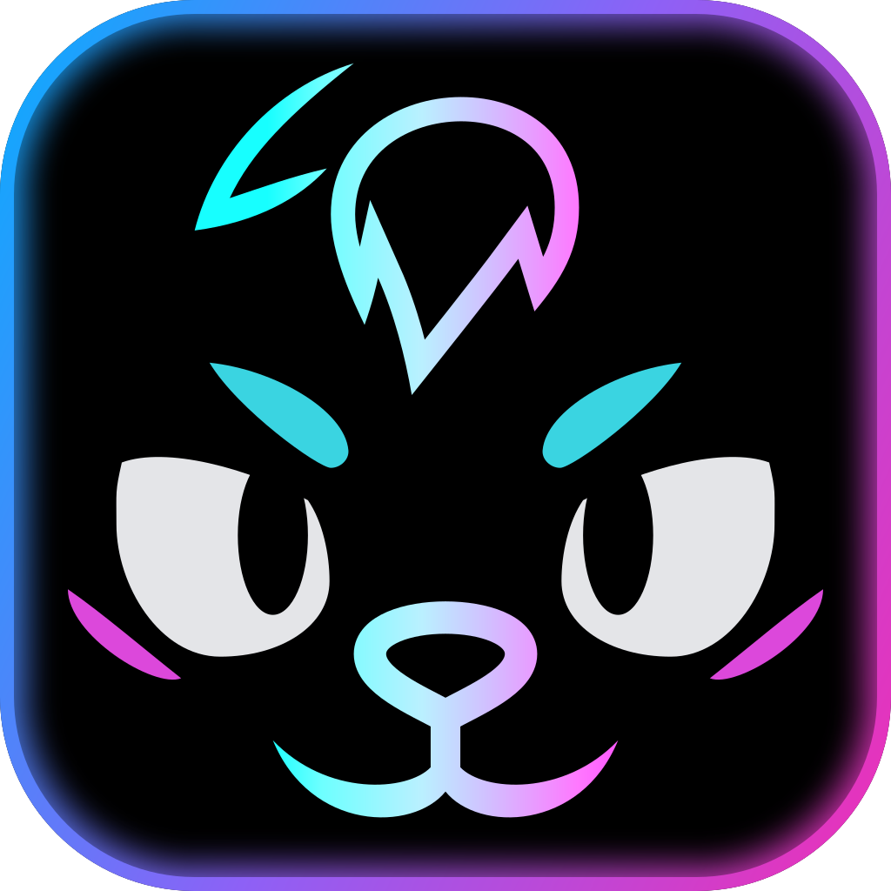
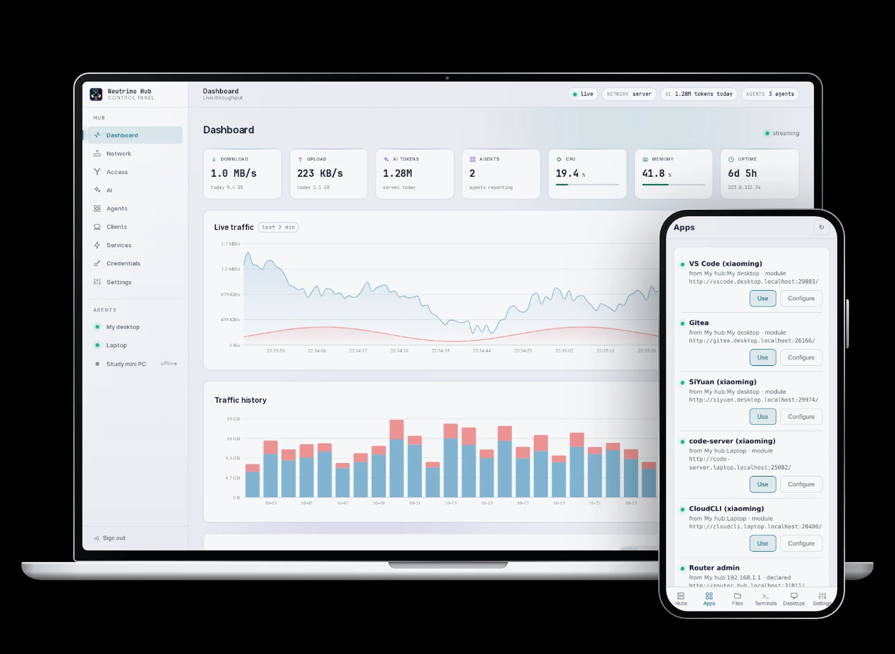
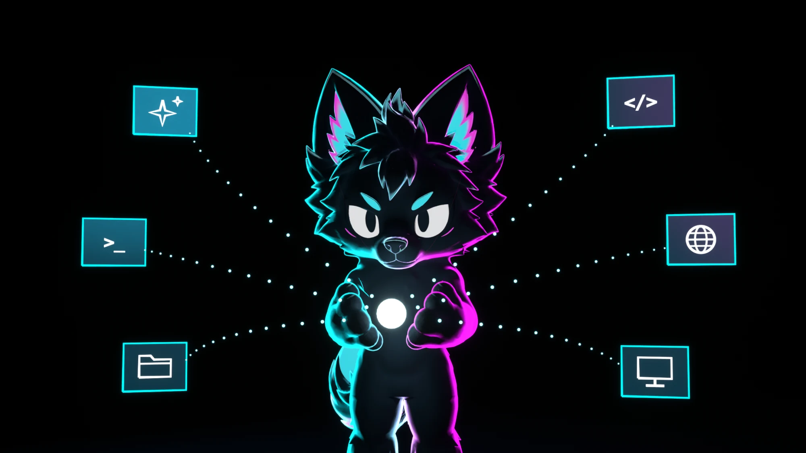
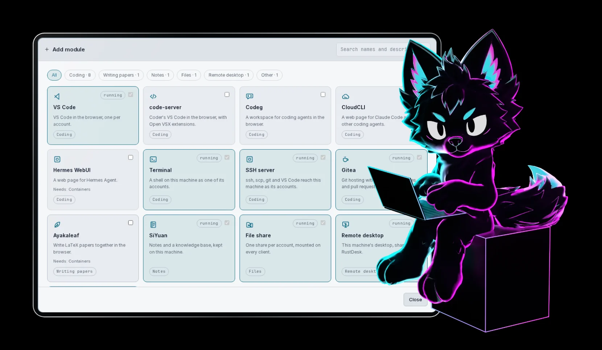
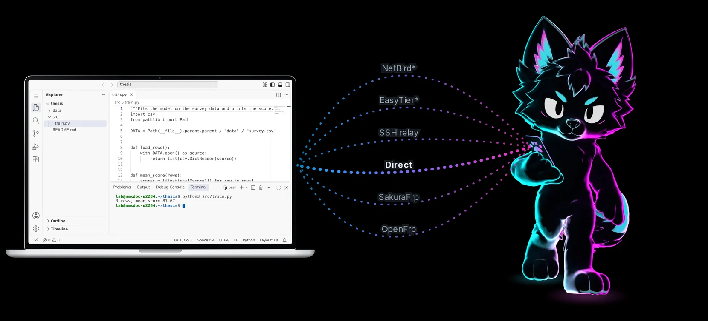
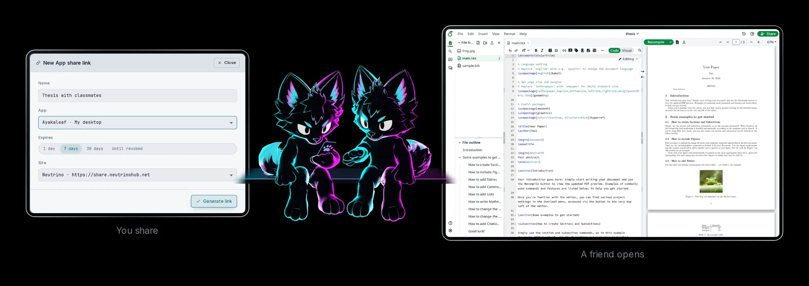

<div align="center">



# Neutrino Hub

[neutrinohub.net](https://neutrinohub.net/en/)

**Deploy apps in one click and use them anywhere**

[简体中文](README.md) · **English**

[](LICENSE)
[](https://github.com/iffiX/neutrino/releases)
[](https://cnb.cool/iffi-X/neutrino/-/releases)
[](https://neutrinohub.net/en/reference/platforms)
[](https://linux.do/t/topic/3148299) <!-- scan: allow -->
[](https://www.v2ex.com/t/1255790)

[](https://github.com/iffiX/neutrino/actions/workflows/ci.yml)
[](https://github.com/iffiX/neutrino/actions/workflows/release.yml)
[](https://app.codecov.io/gh/iffiX/neutrino)
[](https://app.codacy.com/gh/iffiX/neutrino/dashboard?utm_source=gh&utm_medium=referral&utm_content=&utm_campaign=Badge_grade)
[](https://github.com/iffiX/neutrino/actions/workflows/ci.yml)
[](https://github.com/iffiX/neutrino)

**[Live demo](https://neutrinohub.net/demo/)** · **[Install and docs](https://neutrinohub.net/en/)** · [Download](https://github.com/iffiX/neutrino/releases/latest)



</div>

## What it is

Neutrino Hub is a panel for deploying apps plus secure routing for reaching them from outside, built for programmers and students.

- **Panel**: installs on the Windows, macOS or Linux computer you already own. One click installs an app, and one panel holds everything.
- **Outside access routing**: scan a code once and your phone opens those apps from anywhere. Six ways connect the two, encrypted all the way between the device and the hub.

**Deploy it on your own computer. You need no domain and no extra server.**

Claude Code on your phone, the lab machine's VS Code from your dorm room, a classmate editing your thesis with you: none of them needs environment setup or an open port anymore.



## Deploy in one click

Pick an app and it installs in one click, with no environment to prepare and no system to replace. Containers deploy the same way on Windows, macOS and Linux. Each machine picks the fastest of several download sources, so installs stay quick and reliable.



| Use | Apps |
| --- | --- |
| System access | [Remote desktop](https://neutrinohub.net/en/deploy/remote_desktop), [File share](https://neutrinohub.net/en/deploy/file_share), [Terminal](https://neutrinohub.net/en/deploy/terminal), [SSH](https://neutrinohub.net/en/deploy/ssh) |
| Writing code | [VS Code](https://neutrinohub.net/en/deploy/vscode), [code-server](https://neutrinohub.net/en/deploy/code_server) |
| AI workflows | [Claude Code](https://neutrinohub.net/en/deploy/claude_code), [Codex](https://neutrinohub.net/en/deploy/codex), [CloudCLI](https://neutrinohub.net/en/deploy/cloudcli), [Codeg](https://neutrinohub.net/en/deploy/codeg), [Hermes WebUI](https://neutrinohub.net/en/deploy/hermes_webui) |
| Writing papers | [Ayakaleaf](https://neutrinohub.net/en/deploy/ayakaleaf) |
| Notes | [SiYuan](https://neutrinohub.net/en/deploy/siyuan) |
| Hosting code | [Gitea](https://neutrinohub.net/en/deploy/gitea) |
| Containers | [Containers](https://neutrinohub.net/en/deploy/containers) |

## Use it anywhere

Scan a code once with your phone, then open your computer's apps from the subway, a train, in-flight Wi-Fi or another country. Six ways connect the two, and smart routing takes the fastest\*.



The client runs on Windows, macOS, Linux, Android and iOS, with apps, the desktop, terminals, files and SSH already set up.

\* You pick NetBird and EasyTier by hand; the rest are automatic. iOS leaves those two out, and you need a US App Store account to install their own apps.

## Share with a link

Select **Share** on any web app to get a link. A friend opens it in a browser with nothing to install. The link expires on its own, and you can revoke it sooner.



**The share address, share.neutrinohub.net, serves only a static client of under 40 KB. It opens no extra connection to any Neutrino server. The connection between the visitor's browser and the hub is encrypted all the way, and third-party lines cannot read it. You can also host your own copy of the page.**

## Why Neutrino Hub

- **Complete**: apps, the desktop, terminals, files and SSH. One click installs them, and the client has them ready.
- **Secure**: encrypted all the way between a device and the hub, and third-party lines cannot read it. Neutrino's service port strictly guards every app, and only people you approve get in.
- **Yours**: no server, domain or special hardware to buy. Neutrino runs no public server, and a share connects only to your hub.
- **Free**: manage several computers, wake them over the LAN and connect worldwide, with no limit on users or traffic. All free.

| | Neutrino Hub | 1Panel | Cosmos | Olares | Tailscale | ToDesk | fnOS |
| --- | --- | --- | --- | --- | --- | --- | --- |
| OS support | ✅ All three | ❌ Linux only | ❌ Linux only | ❌ Its own OS | ✅ All three | ✅ All three | ❌ Its own OS |
| One-click apps | ✅ Yes | ✅ Yes | ✅ Yes | ✅ Yes | ❌ No | ❌ No | ✅ Yes |
| Remote desktop | ✅ Ready | ❌ No | ❌ DIY | ❌ DIY | ❌ DIY | ✅ Yes | ❌ DIY |
| Mounted drive | ✅ Ready | ❌ Web only | ❌ Paid plan | ❌ LAN only | ❌ Transfer only | ❌ Transfer only | ✅ Yes |
| App sharing | ✅ One link | ❌ No | ❌ Needs a domain | ❌ Files only | ✅ Yes | ❌ Needs an install | ❌ Files only |
| Encrypted transport | ✅ Yes | ❌ DIY | ❌ Needs a domain | ✅ Yes | ✅ Yes | ✅ Yes | ❌ Not stated |
| Fingerprint on a scan | ✅ None | ❌ Yes | ❌ Yes | ❌ Yes | ✅ None | ✅ None | ❌ Yes |
| Ways to connect | ✅ 6 | ❌ Open a port | ❌ Open a port | ❌ 3 | ❌ 1 | ❌ 1 | ❌ 2 |
| Global access | ✅ Free | ❌ Open a port | ❌ Open a port | ❌ $19.8/month | ✅ Free | ❌ ¥66/month | ❌ Paid extra |
| Paid tier | ✅ None | ❌ Yes | ❌ Yes | ❌ Yes | ❌ Yes | ❌ Yes | ❌ Yes |

Prices and limits come from each vendor's page on 2026-10-30. Third-party services set their own bandwidth and account rules. [Full comparison](https://neutrinohub.net/en/compare)

## Install

Install the hub on a computer and the app on your phone, then scan once:

1. On the computer you want to reach, install the hub. Search for **Neutrino Hub**, open it, and follow the wizard in your browser.

   [](https://github.com/iffiX/neutrino/releases/latest)

   

1. On your phone or another computer, install the client. An iPhone needs [self-signing](https://neutrinohub.net/en/access/ios).

   [](https://github.com/iffiX/neutrino/releases/latest)

   

1. On the panel's **Clients** page, select **New client link**. A phone scans it under **Join a hub**, and a computer pastes it on the **Hubs** page.

In mainland China, use the [mainland edition](https://cnb.cool/iffi-X/neutrino/-/releases). It has no proxy and no side gateway.

<details>
<summary><b>Install with one command</b></summary>

Linux and macOS:

```bash
# Hub
curl -fsSL https://github.com/iffiX/neutrino/releases/latest/download/install.sh | sh
# Client
curl -fsSL https://github.com/iffiX/neutrino/releases/latest/download/install.sh | sh -s -- client
```

Windows, in an administrator PowerShell:

```powershell
# Hub
irm https://github.com/iffiX/neutrino/releases/latest/download/install.ps1 | iex
# Client
& ([scriptblock]::Create((irm https://github.com/iffiX/neutrino/releases/latest/download/install.ps1))) client
```

Mainland edition, Linux and macOS:

```bash
# Hub
curl -fsSL https://cnb.cool/iffi-X/neutrino/-/git/raw/main/packaging/install/install.sh | sh
# Client
curl -fsSL https://cnb.cool/iffi-X/neutrino/-/git/raw/main/packaging/install/install.sh | sh -s -- client
```

Mainland edition, Windows, in an administrator PowerShell:

```powershell
# Hub
irm https://cnb.cool/iffi-X/neutrino/-/git/raw/main/packaging/install/install.ps1 | iex
# Client
& ([scriptblock]::Create((irm https://cnb.cool/iffi-X/neutrino/-/git/raw/main/packaging/install/install.ps1))) client
```

</details>

<details>
<summary><b>A computer with no desktop</b></summary>

On a dev board, a router or a computer you reach only over SSH, run the wizard in a terminal. Linux and macOS:

```bash
sudo nhub setup
```

Windows, in an administrator PowerShell:

```powershell
nhub setup
```

</details>

To add another computer, see [Agents](https://neutrinohub.net/en/hub/agents). For upgrades and removal, see [Upgrade from 0.5](https://neutrinohub.net/en/hub/upgrade) and [Uninstall](https://neutrinohub.net/en/hub/uninstall).

## FAQ

<details>
<summary><b>How is it different from 1Panel or aaPanel</b></summary>

They manage websites and databases on Linux servers. Neutrino Hub manages the work tools on your own Windows, macOS or Linux computers, and has six ways to reach them from outside.

</details>

<details>
<summary><b>How is it different from UU, Sunlogin or ToDesk</b></summary>

They are remote desktops. Here the remote desktop is one item next to editors, AI coding, terminals and files, and a phone reaches apps, files, terminals and desktops.

</details>

<details>
<summary><b>How is it different from Claude's built-in remote and agent aggregators</b></summary>

Agent aggregators such as Codeg, CloudCLI and Hermes WebUI are apps Neutrino Hub deploys. It installs them and lets you connect to them from other devices. Claude's built-in remote is a feature Anthropic provides, and it is not on the app list.

</details>

<details>
<summary><b>Is it secure, and do I have to register</b></summary>

You do not need to register. You generate join links on the panel, and only people you approve get in. Every connection goes through one protected port on the hub, encrypted all the way between the device and the hub. See [Security model](https://neutrinohub.net/en/share/security).

</details>

## Docs and community

- [Docs](https://neutrinohub.net/en/), starting with the [quick start](https://neutrinohub.net/en/quick-start)
- [LINUX DO post](https://linux.do/t/topic/3148299), [V2EX post](https://www.v2ex.com/t/1255790)
- Pull requests, docs and tutorials are welcome

## Supported apps

Neutrino Hub supports the apps below, and the list is growing fast.

Anything else works too. You can declare your own service, with several ports and HTTP entries. A port a container publishes appears as an app automatically.

| App | What it is | How to deploy |
| --- | --- | --- |
| [VS Code](https://github.com/microsoft/vscode) | Microsoft's code editor, running in a browser | [Deploy VS Code](https://neutrinohub.net/en/deploy/vscode) |
| [code-server](https://github.com/coder/code-server) | VS Code as an open source web app | [Deploy code-server](https://neutrinohub.net/en/deploy/code_server) |
| [Claude Code](https://github.com/anthropics/claude-code) | The command-line AI coding tool from Anthropic | [Deploy Claude Code](https://neutrinohub.net/en/deploy/claude_code) |
| [Codex](https://github.com/openai/codex) | The command-line AI coding tool from OpenAI | [Deploy Codex](https://neutrinohub.net/en/deploy/codex) |
| [CloudCLI](https://github.com/siteboon/claudecodeui) | A web page for Claude Code and other AI coding tools | [Deploy CloudCLI](https://neutrinohub.net/en/deploy/cloudcli) |
| [Codeg](https://github.com/spacering-net/codeg) | An AI coding workspace with Claude Code, Codex and Gemini on one page | [Deploy Codeg](https://neutrinohub.net/en/deploy/codeg) |
| [Hermes WebUI](https://github.com/nesquena/hermes-webui) | A web page for the Hermes Agent assistant | [Deploy Hermes WebUI](https://neutrinohub.net/en/deploy/hermes_webui) |
| [Ayakaleaf](https://github.com/ayaka-notes/ayakaleaf-pro) | A web editor for writing LaTeX papers with classmates | [Deploy Ayakaleaf](https://neutrinohub.net/en/deploy/ayakaleaf) |
| [SiYuan](https://github.com/siyuan-note/siyuan) | Notes and a knowledge base, kept on your computer | [Deploy SiYuan](https://neutrinohub.net/en/deploy/siyuan) |
| [Gitea](https://github.com/go-gitea/gitea) | A self-hosted code hosting service, similar to GitHub | [Deploy Gitea](https://neutrinohub.net/en/deploy/gitea) |
| [Podman](https://github.com/podman-container-tools/podman) | A container engine for software the list leaves out | [Deploy containers](https://neutrinohub.net/en/deploy/containers) |
| [Samba](https://www.samba.org/) | Mounts a folder on your system at a path or drive letter on the client for direct reading and writing | [Deploy file sharing](https://neutrinohub.net/en/deploy/file_share) |

## Acknowledgements

Neutrino Hub ships with:

- [Xray-core](https://github.com/XTLS/Xray-core): the network core
- [CLIProxyAPI](https://github.com/router-for-me/CLIProxyAPI): the AI gateway
- [cpa-usage-keeper](https://github.com/Willxup/cpa-usage-keeper): the gateway's usage records
- [NetBird](https://github.com/netbirdio/netbird): a virtual network with a management plane
- [EasyTier](https://github.com/EasyTier/EasyTier): a decentralised virtual network
- [frp](https://github.com/fatedier/frp): the client for SakuraFrp and OpenFrp
- [cc-switch](https://github.com/SaladDay/cc-switch-cli): switches the configuration of Claude Code, Codex and Gemini CLI
- [RustDesk](https://github.com/rustdesk/rustdesk): the remote desktop host and viewer
- [dnsmasq](https://thekelleys.org.uk/dnsmasq/doc.html): DHCP and DNS on the local network
- [hostapd](https://w1.fi/hostapd/): the wireless access point
- [v2fly geodata](https://github.com/v2fly/domain-list-community): the domain and IP lists for split routing

## License

Neutrino is distributed under the [MIT](LICENSE) and [AGPL-3.0](client/android/LICENSE) licenses. The Android and iOS apps use AGPL-3.0. Author: Muhan Li / iffiX.

<div align="center">


**Let creation be fun again.**

Spend less time maintaining the environment.<br/>
Spend more of it on whatever made you build one in the first place.

</div>
