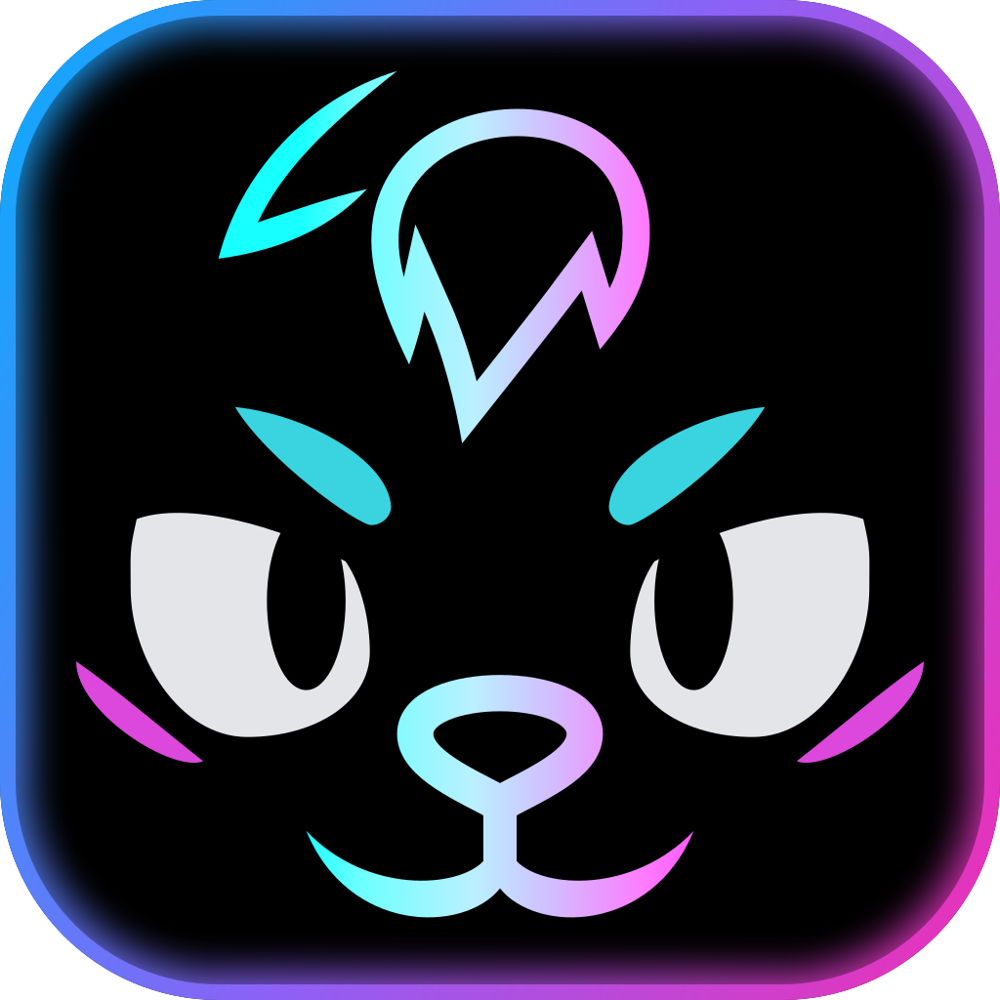
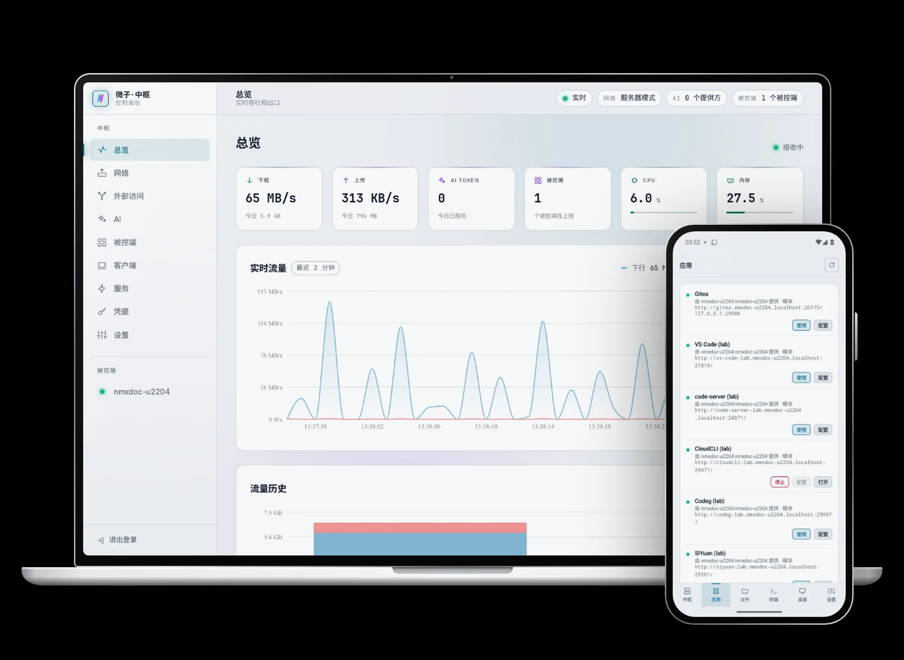
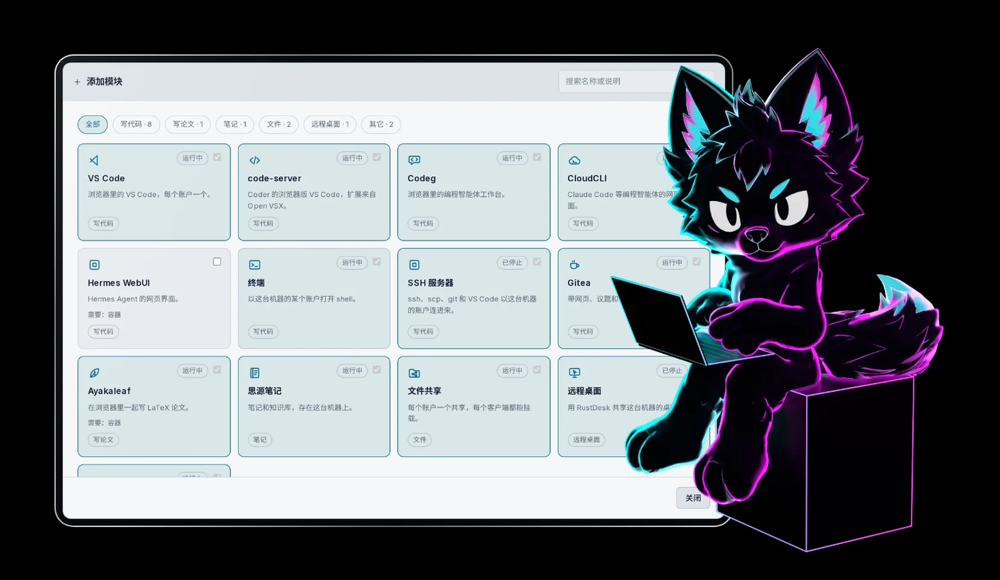
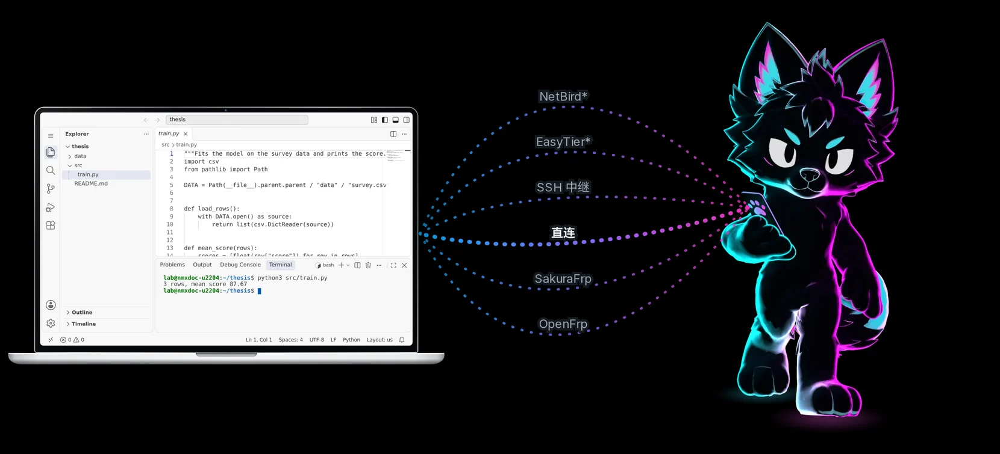
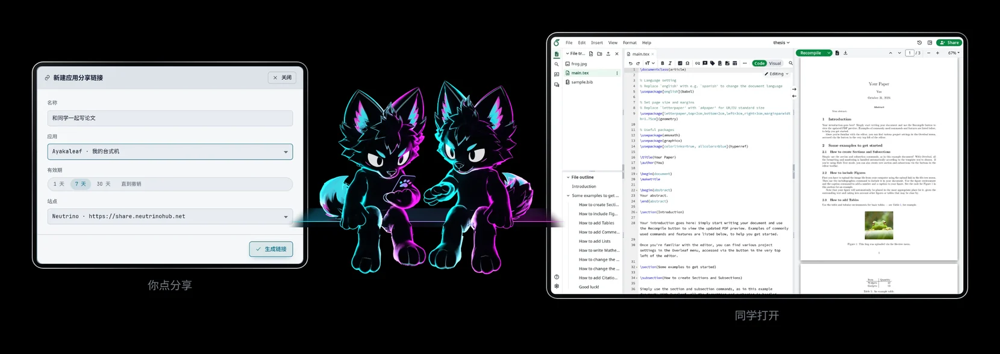

<div align="center">



# 微子·中枢

**一键部署应用，走到哪用到哪**

**简体中文** · [English](README.en.md)

[](LICENSE)
[](https://github.com/iffiX/neutrino/releases)
[](https://cnb.cool/iffi-X/neutrino/-/releases)
[](https://docs.neutrinohub.net/reference/platforms)
[](https://linux.do/t/topic/3008982) <!-- scan: allow -->
[](https://www.v2ex.com/t/1247759)

[](https://github.com/iffiX/neutrino/actions/workflows/ci.yml)
[](https://github.com/iffiX/neutrino/actions/workflows/release.yml)
[](https://app.codecov.io/gh/iffiX/neutrino)
[](https://app.codacy.com/gh/iffiX/neutrino/dashboard?utm_source=gh&utm_medium=referral&utm_content=&utm_campaign=Badge_grade)
[](https://github.com/iffiX/neutrino/actions/workflows/ci.yml)
[](https://github.com/iffiX/neutrino)

**[在线演示](https://demo.neutrinohub.net/)** · **[安装](#安装)** · **[文档](https://docs.neutrinohub.net/)** · [下载](https://github.com/iffiX/neutrino/releases/latest)



</div>

## 微子·中枢是什么

微子·中枢是一个部署应用的面板，加一套安全的外部访问路由，给程序员和学生用。

- **面板**：装在你已有的 Windows、macOS 或 Linux 电脑上。应用点一下就装好，全都在一个面板里管。
- **外部访问路由**：手机扫一次码，在外面也能打开这些应用。有 6 种连法，全程端对端加密。

**部署在自己电脑上就行，不需要域名，也不需要额外的服务器。**

想在手机上接着跑 Claude Code，在宿舍打开实验室的 VS Code，再拉同学一起改论文，每样软件都不用再配环境、开端口。


## 一键部署

想用什么，点一下就装好。不用配环境，不用换系统。容器也一样，Windows、macOS、Linux 同样的办法部署。多个下载源自动选最快的，安装又稳又快。



| 用途 | 应用 |
| --- | --- |
| 系统访问 | [远程桌面](https://docs.neutrinohub.net/deploy/remote_desktop)、[传文件](https://docs.neutrinohub.net/deploy/file_share)、[终端](https://docs.neutrinohub.net/deploy/terminal)、[SSH](https://docs.neutrinohub.net/deploy/ssh) |
| 写代码 | [VS Code](https://docs.neutrinohub.net/deploy/vscode)、[code-server](https://docs.neutrinohub.net/deploy/code_server) |
| AI 工作流 | [CloudCLI](https://docs.neutrinohub.net/deploy/cloudcli)、[Codeg](https://docs.neutrinohub.net/deploy/codeg)、[Hermes WebUI](https://docs.neutrinohub.net/deploy/hermes_webui) |
| 写论文 | [Ayakaleaf](https://docs.neutrinohub.net/deploy/ayakaleaf) |
| 记笔记 | [思源笔记](https://docs.neutrinohub.net/deploy/siyuan) |
| 放代码 | [Gitea](https://docs.neutrinohub.net/deploy/gitea) |
| 跑容器 | [容器](https://docs.neutrinohub.net/deploy/containers) |

## 到处使用

手机扫一次码，地铁、高铁、飞机 Wi-Fi、国外都能用电脑上的软件。6 种连法，智能路由自动走最快的一条\*。



客户端有 Windows、macOS、Linux、Android 和 iOS 版，应用、桌面、终端、文件和 SSH 都配好了。

\* NetBird 和 EasyTier 要手动选择，其余的自动。iOS 不含这两种，要用美区账号自己安装它们的 App。

## 任意分享

任何网页应用，点“分享”得到一个链接。同学用浏览器打开就能用，什么都不用装。到期失效，也能随时收回。



**分享地址 share.neutrinohub.net 只提供一个不到 30 KB 的静态客户端，不会另外连到微子的服务器，全部端对端。你也可以自己部署这个页面的镜像。**

## 为什么选它

- **全能**：应用、桌面、终端、文件、SSH。点一下装上，客户端里都配好了。
- **安全**：端对端加密。只有你许可的人才能访问。
- **自主**：不用买服务器、域名和专用设备。微子不提供公开服务器，分享也只连你的中枢。
- **免费**：管理多台电脑，局域网唤醒，全球连接，不限用户数，不限流量。全部免费。

| | 微子·中枢 | 1Panel | Cosmos | Olares | Tailscale | ToDesk | 飞牛 |
| --- | --- | --- | --- | --- | --- | --- | --- |
| 系统支持 | ✅ 三系统 | ❌ 仅 Linux | ❌ 仅 Linux | ❌ 仅它的系统 | ✅ 三系统 | ✅ 三系统 | ❌ 仅它的系统 |
| 一键装应用 | ✅ 有 | ✅ 有 | ✅ 有 | ✅ 有 | ❌ 没有 | ❌ 没有 | ✅ 有 |
| 远程桌面 | ✅ 配好了 | ❌ 没有 | ❌ 自己装 | ❌ 自己装 | ❌ 自己装 | ✅ 有 | ❌ 自己装 |
| 文件盘挂载 | ✅ 配好了 | ❌ 只有网页 | ❌ 付费版 | ❌ 局域网 | ❌ 只传文件 | ❌ 只传文件 | ✅ 有 |
| 应用分享 | ✅ 一个链接 | ❌ 没有 | ❌ 要域名 | ❌ 只有文件 | ✅ 有 | ❌ 要装软件 | ❌ 只有文件 |
| 端对端加密 | ✅ 有 | ❌ 自己配 | ❌ 要域名 | ✅ 有 | ✅ 有 | ✅ 有 | ❌ 未声明 |
| 扫描有指纹 | ✅ 没有 | ❌ 有 | ❌ 有 | ❌ 有 | ✅ 没有 | ✅ 没有 | ❌ 有 |
| 连回电脑的办法 | ✅ 6 种 | ❌ 自己开端口 | ❌ 自己开端口 | ❌ 3 种 | ❌ 1 种 | ❌ 1 种 | ❌ 2 种 |
| 全球连接 | ✅ 免费 | ❌ 自己开端口 | ❌ 自己开端口 | ❌ $19.8/月 | ✅ 免费 | ❌ ¥66/月 | ❌ 另收费 |
| 付费档 | ✅ 没有 | ❌ 有 | ❌ 有 | ❌ 有 | ❌ 有 | ❌ 有 | ❌ 有 |

价格和限制来自 2026-10-30 各家页面。第三方服务以它们的带宽和账号规定为准。[完整对比](https://docs.neutrinohub.net/compare)

## 安装

电脑装中枢，手机装 App，扫一次码就能用。

1. 在要远程访问的电脑上装中枢，装好后搜索 **微子中枢** 并打开，跟着浏览器里的向导走。

   [](https://github.com/iffiX/neutrino/releases/latest)
   [](https://github.com/iffiX/neutrino/releases/latest)
   [](https://github.com/iffiX/neutrino/releases/latest)

   

1. 在手机或另一台电脑上装客户端。iPhone 要[自己签名](https://docs.neutrinohub.net/access/ios)。

   [](https://github.com/iffiX/neutrino/releases/latest)
   [](https://github.com/iffiX/neutrino/releases/latest)
   [](https://github.com/iffiX/neutrino/releases/latest)
   [](https://github.com/iffiX/neutrino/releases/latest)
   [](https://github.com/iffiX/neutrino/releases/latest)

   

1. 在面板的 **客户端** 页按 **新建客户端链接**。手机在 App 的 **加入中枢** 里扫码，电脑把链接粘到 **中枢** 页。

国内网络用[国内版](https://cnb.cool/iffi-X/neutrino/-/releases)，无部分网络功能。

<details>
<summary><b>用一条命令安装</b></summary>

Linux 和 macOS：

```bash
# 中枢
curl -fsSL https://github.com/iffiX/neutrino/releases/latest/download/install.sh | sh
# 客户端
curl -fsSL https://github.com/iffiX/neutrino/releases/latest/download/install.sh | sh -s -- client
```

Windows，在管理员 PowerShell 里：

```powershell
# 中枢
irm https://github.com/iffiX/neutrino/releases/latest/download/install.ps1 | iex
# 客户端
& ([scriptblock]::Create((irm https://github.com/iffiX/neutrino/releases/latest/download/install.ps1))) client
```

国内版，Linux 和 macOS：

```bash
# 中枢
curl -fsSL https://cnb.cool/iffi-X/neutrino/-/git/raw/main/packaging/install/install.sh | sh
# 客户端
curl -fsSL https://cnb.cool/iffi-X/neutrino/-/git/raw/main/packaging/install/install.sh | sh -s -- client
```

国内版，Windows，在管理员 PowerShell 里：

```powershell
# 中枢
irm https://cnb.cool/iffi-X/neutrino/-/git/raw/main/packaging/install/install.ps1 | iex
# 客户端
& ([scriptblock]::Create((irm https://cnb.cool/iffi-X/neutrino/-/git/raw/main/packaging/install/install.ps1))) client
```

</details>

<details>
<summary><b>没有桌面的电脑</b></summary>

开发板、路由器和只能 SSH 的电脑，在终端里运行向导。Linux 和 macOS：

```bash
sudo nhub setup
```

Windows，在管理员 PowerShell 里：

```powershell
nhub setup
```

</details>

再加一台电脑见[添加电脑](https://docs.neutrinohub.net/hub/add_machine)，升级和卸载见[升级](https://docs.neutrinohub.net/hub/upgrade)和[卸载](https://docs.neutrinohub.net/hub/uninstall)。

## 常见问题

<details>
<summary><b>和 1Panel、宝塔有什么区别</b></summary>

它们管 Linux 服务器上的网站和数据库。微子·中枢管你自己 Windows、macOS、Linux 电脑上的工作软件，还带 6 种连回来的办法。

</details>

<details>
<summary><b>和 UU、向日葵、ToDesk 有什么区别</b></summary>

它们是远程桌面。这里的远程桌面只是一项，旁边还有编辑器、AI 写代码、终端和文件，手机上打开的是网页和终端。

</details>

<details>
<summary><b>和 Claude 自带的远程、各种 agent 聚合工具有什么区别</b></summary>

它们是微子·中枢部署的应用，比如 Codeg、CloudCLI、Hermes WebUI。微子·中枢负责把它们装好，让你安全地连上。

</details>

<details>
<summary><b>安全吗，要注册吗</b></summary>

不开放注册，客户端的密钥由你自己生成，只有你许可的人才能访问。所有连接都走中枢一个受保护的端口，端对端加密。详情见[安全设计](https://docs.neutrinohub.net/share/security)。

</details>

## 文档和社区

- [文档](https://docs.neutrinohub.net/)，新手从[快速上手](https://docs.neutrinohub.net/quick-start)读起
- [LINUX DO 介绍帖](https://linux.do/t/topic/3008982)，[V2EX 帖子](https://www.v2ex.com/t/1247759)
- 欢迎提 PR、补文档、写教程

## 支持的应用

微子·中枢支持以下应用，这个列表正在快速扩张。

列表里没有的也能用：你可以自己声明服务，填多个端口和 HTTP 入口。容器暴露的端口会自动添加为应用，全部自动。

| 应用 | 是什么 | 怎么部署 |
| --- | --- | --- |
| [VS Code](https://github.com/microsoft/vscode) | 微软的代码编辑器，开在浏览器里 | [部署 VS Code](https://docs.neutrinohub.net/deploy/vscode) |
| [code-server](https://github.com/coder/code-server) | 开源的网页版 VS Code | [部署 code-server](https://docs.neutrinohub.net/deploy/code_server) |
| [CloudCLI](https://github.com/siteboon/claudecodeui) | Claude Code 等 AI 编程工具的网页界面 | [部署 CloudCLI](https://docs.neutrinohub.net/deploy/cloudcli) |
| [Codeg](https://github.com/spacering-net/codeg) | AI 编程工作台，把 Claude Code、Codex、Gemini 放进一个网页 | [部署 Codeg](https://docs.neutrinohub.net/deploy/codeg) |
| [Hermes WebUI](https://github.com/nesquena/hermes-webui) | AI 助手 Hermes Agent 的网页界面 | [部署 Hermes WebUI](https://docs.neutrinohub.net/deploy/hermes_webui) |
| [Ayakaleaf](https://github.com/ayaka-notes/ayakaleaf-pro) | 写 LaTeX 论文的网页编辑器，能和同学一起写 | [部署 Ayakaleaf](https://docs.neutrinohub.net/deploy/ayakaleaf) |
| [思源笔记](https://github.com/siyuan-note/siyuan) | 笔记和知识库软件，笔记存在自己电脑上 | [部署思源笔记](https://docs.neutrinohub.net/deploy/siyuan) |
| [Gitea](https://github.com/go-gitea/gitea) | 自己架的 GitHub | [部署 Gitea](https://docs.neutrinohub.net/deploy/gitea) |
| [Podman](https://github.com/podman-container-tools/podman) | 跑容器的引擎，列表里没有的软件也能跑 | [部署容器](https://docs.neutrinohub.net/deploy/containers) |
| [Samba](https://www.samba.org/) | 把电脑上的文件夹变成别的设备上的一个盘 | [部署文件共享](https://docs.neutrinohub.net/deploy/file_share) |

## 致谢

微子·中枢自带这些软件：

- [Xray-core](https://github.com/XTLS/Xray-core)：网络内核
- [CLIProxyAPI](https://github.com/router-for-me/CLIProxyAPI)：AI 网关
- [cpa-usage-keeper](https://github.com/Willxup/cpa-usage-keeper)：网关的用量记录
- [NetBird](https://github.com/netbirdio/netbird)：带管理面的虚拟网
- [EasyTier](https://github.com/EasyTier/EasyTier)：去中心化的虚拟网
- [frp](https://github.com/fatedier/frp)：连 SakuraFrp 和 OpenFrp 的客户端
- [cc-switch](https://github.com/SaladDay/cc-switch-cli)：切换 Claude Code、Codex 和 Gemini CLI 的配置
- [RustDesk](https://github.com/rustdesk/rustdesk)：远程桌面的主机和查看器
- [dnsmasq](https://thekelleys.org.uk/dnsmasq/doc.html)：局域网的 DHCP 和 DNS
- [hostapd](https://w1.fi/hostapd/)：无线接入点
- [v2fly geodata](https://github.com/v2fly/domain-list-community)：分流用的域名和 IP 列表

## 许可证

[MIT](LICENSE)。Android 应用和 iOS 应用使用 AGPL-3.0。

<div align="center">


**让创造重新变得有趣。**

少花点时间维护环境。<br/>
多花点时间，做当初让你搭起这套环境的事。

</div>
